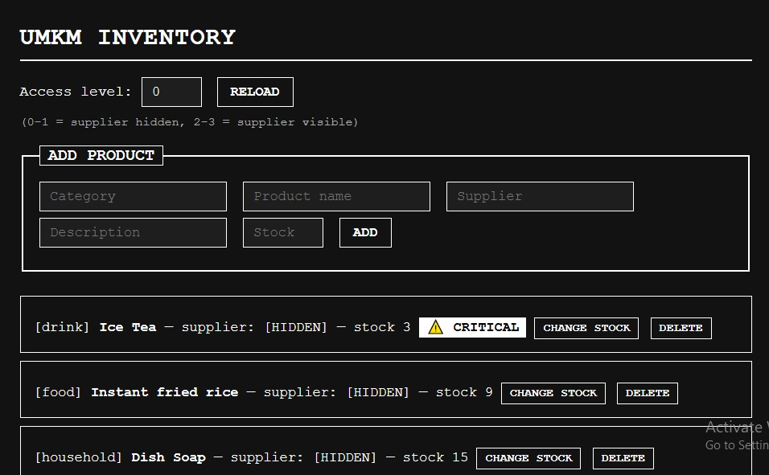
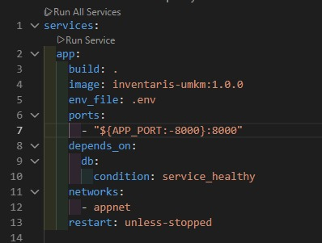
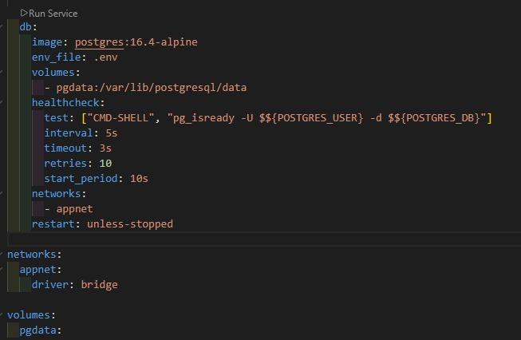
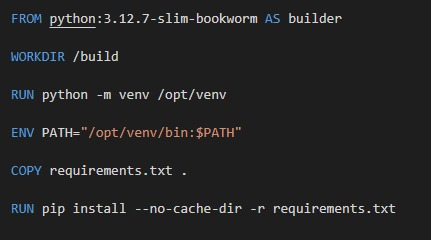
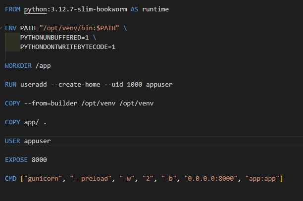

# Inventory-Registry-Cloud-Service

This is a simple web app and REST API that helps small shop owners track their product stock. Users can add products and update stock, and any item with 5 or fewer units is automatically marked as critical. Supplier names are hidden unless the user has a high enough access level, stock cannot drop by more than 20 at once, and deleted products are only soft-deleted with every change saved in an audit log. The project is built with Flask and PostgreSQL, and runs fully in containers using Docker Compose.

## Run Guide

git clone <URL-REPO-ANDA>
cd inventaris-umkm
cp .env.example .env
docker compose up -d --build

Open http://localhost:8000

To stop, use 'docker compose down' (keep data) or 'docker compose down -v' (Delete data)

## Reasoning
I chose this project because many small shops in Indonesia (UMKM) still track their stock in notebooks, so they often find out an item is gone only when a customer asks for it. I wanted to build something simple that solves a real problem. I also made it in docker comtainer so it easier to move around and open in another platform.

## Dokumentation

*App Homepage*

*Docker Compose Yml*

*Dockerfile*

---

- Article: [Article Link](https://rodiego.netlify.app/inventoris)
- Demo video: [Youtube Link](https://youtu.be/1C-Er72Q9bc)

